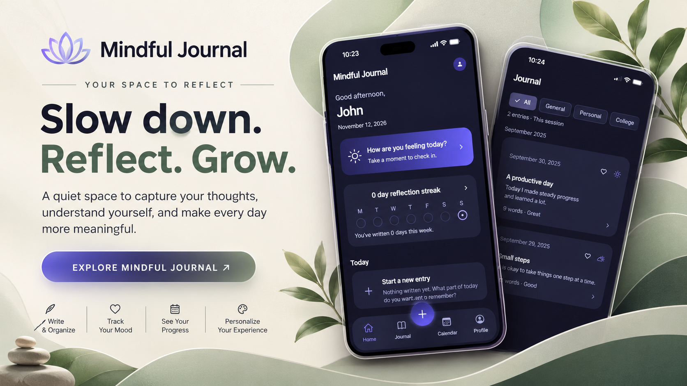
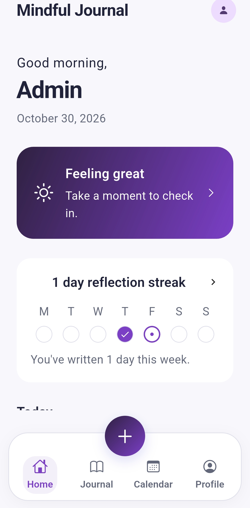
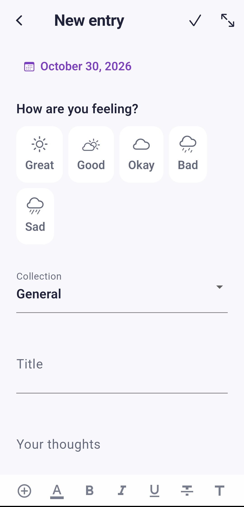
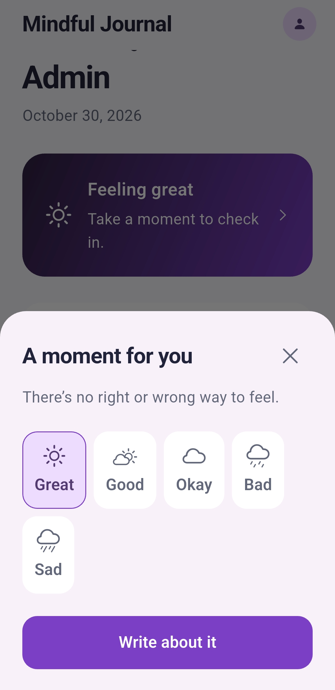
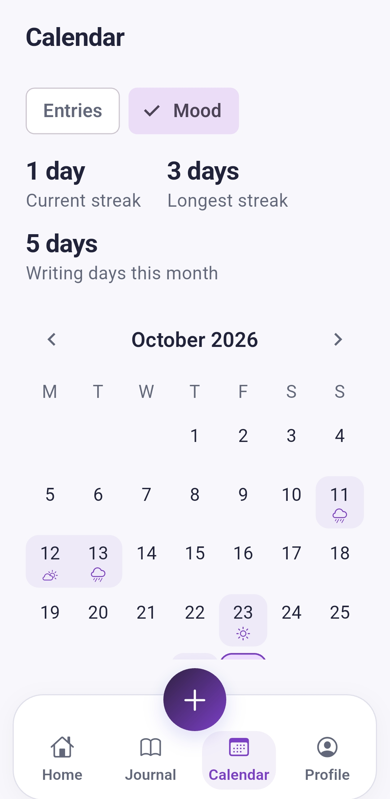
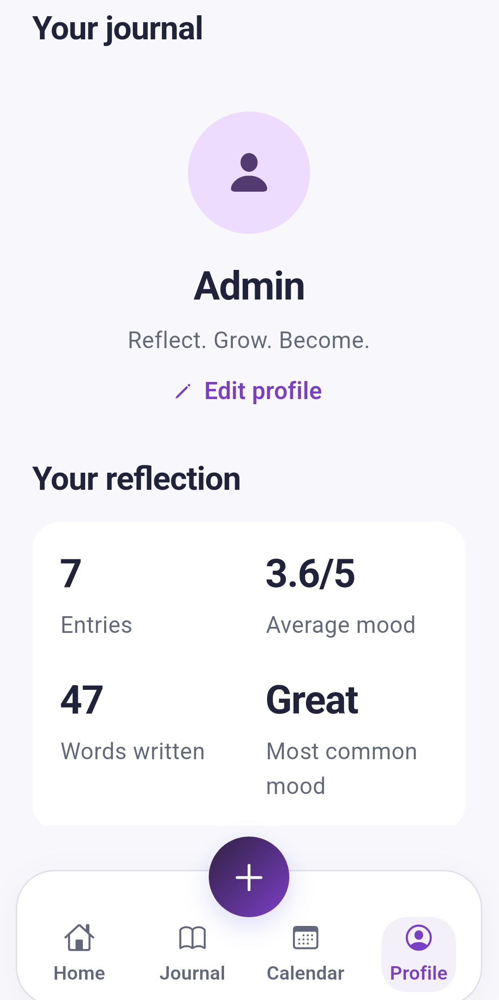
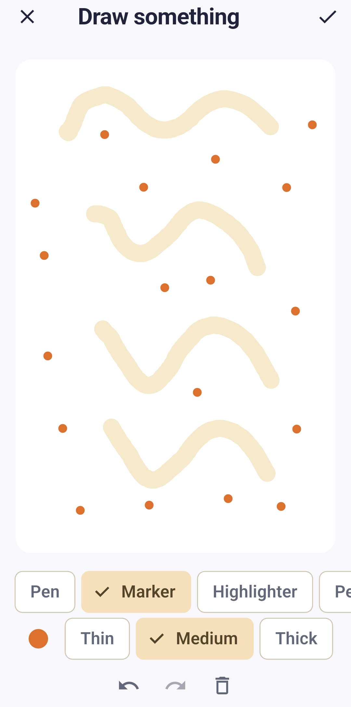

 <div align="center">



<br/>

# Mindful Journal

### Slow down. Reflect. Grow.

*A little space to pause, understand yourself, and grow.*

A thoughtfully designed personal journaling application built with Flutter. Capture everyday thoughts, track your moods, explore your creativity, and revisit meaningful moments—all in a private, local-first experience.

**Flutter · Dart · Local-first Storage · Responsive Design**

[Explore Features](#-features) · [App Preview](#-app-preview) · [Getting Started](#-getting-started) · [Documentation](#-documentation)

</div>

---

## Overview

Life moves quickly. Mindful Journal creates a space to slow down.

Designed around the idea that reflection should feel natural and personal, Mindful Journal brings writing, mood check-ins, personal history, and creative expression into one cohesive experience.

Its interface combines a refined visual identity with a distraction-conscious writing environment, helping users capture their thoughts without unnecessary complexity.

At its core is a **local-first journaling experience**. Journal entries, associated media, preferences, and related information are stored on the device rather than requiring a hosted account or backend service.

Whether writing a few thoughts at the end of the day or revisiting older memories, Mindful Journal makes everyday reflection feel more intentional.

## App Preview

A closer look at the application's interface, writing experience, and personalization features.

> The screenshots below are intended to show genuine captures of the running application. Upload the actual screenshots using the existing filenames to display them in this section.

### Home & Writing Experience

| Home | Journal Editor |
|:---:|:---:|
|  |  |

### Reflection & Personal History

| Mood Check-in | Calendar |
|:---:|:---:|
|  |  |

### Personalization & Creative Tools

| Profile & Themes | Drawing Canvas |
|:---:|:---:|
|  |  |

*Screenshots should use fictional sample entries and must not expose private journal content.*

## Features

Mindful Journal is designed to support the different ways people reflect, write, and express themselves.

### ✍️ A Personal Writing Space

- Create, read, edit, and delete journal entries, with confirmation before deletion.
- Write with date selection, required-field validation, and word count.
- Protect unfinished writing with unsaved-change safeguards.
- Browse a chronological journal timeline organized by month.
- Search entries locally and filter by mood, media, tags, and favorites.
- Organize thoughts with collections, templates, and checklists.

### 🌿 Mood & Self-Reflection

- Choose from five labeled moods during a check-in.
- Explore writing streaks and calendar history.
- Support backdated journal entries.
- View personal insights, including entry count, average mood, total words, and most common mood.

### 🎨 Creative Expression

- Format writing with text styles, colors, and highlights.
- Use undo, redo, and Focus mode while writing.
- Attach up to four photos and two editable drawings to an entry.
- Preview attached photos with zoom support.
- Create drawings using Pen, Marker, Highlighter, Pencil, and Eraser tools.
- Use drawing undo, redo, and clear actions.

### ✨ Personalization

- Customize your profile and application appearance.
- Choose from eight accent themes or create a custom color.
- Switch between System, Light, and Dark appearance.
- Enjoy a consistent interface across different screen sizes.

### 📱 Designed for Different Screens

- Responsive layouts for phones, tablets, and desktop-sized screens.
- Dedicated Home, Journal, Calendar, and Profile areas.
- Keyboard shortcuts:
  - `Cmd/Ctrl + N` — Create an entry from Home.
  - `Cmd/Ctrl + S` — Save from the editor.
  - `Escape` — Close with unsaved-change protection.
- Accessible controls and clearly labeled mood choices.

## Technology Stack

Built with a Flutter-based architecture and tools selected for a maintainable, responsive application.

| Technology | Purpose |
|---|---|
| **Flutter** | Cross-platform application framework |
| **Dart** | Primary programming language |
| **shared_preferences** | Local preference storage |
| **path_provider** | Access to the application's documents directory |
| **JSON** | Local journal and related data records |
| **Flutter Test** | Application and widget testing |
| **Flutter Analyze** | Static analysis and code quality checks |

**Storage approach:** Journal records and media are maintained locally using JSON records and app-owned files. Image validation and normalization are performed before local storage.

The repository contains Android, iOS, macOS, and web project files. Their presence does not imply that every platform has completed release validation.

## Getting Started

Want to explore the application locally? Follow these steps.

### Prerequisites

Install the following development tools:

- [Flutter SDK](https://docs.flutter.dev/get-started/install)
- [Dart SDK](https://dart.dev/get-dart) — included with Flutter
- [Google Chrome](https://www.google.com/chrome/) — for web development
- [Android Studio](https://developer.android.com/studio) — for Android development
- [Xcode](https://developer.apple.com/xcode/) — for iOS development on macOS

The supplied project notes report verification using **Flutter 3.47.7 stable / Dart 3.13.5**. Matching these versions is recommended when reproducing the documented environment.

### 1. Clone the Repository

```bash
git clone https://github.com/oronex-dev/mindful-journal.git
cd mindful-journal
```

### 2. Check Your Flutter Environment

```bash
flutter doctor -v
```

Make sure the required platform dependencies are installed.

### 3. Install Dependencies

```bash
flutter pub get
```

### 4. Run the Application

```bash
flutter run
```

Flutter will prompt you to select an available device if multiple targets are configured.

For web development, you can use:

```bash
flutter run -d chrome
```

### 5. Run Quality Checks

Analyze the code:

```bash
flutter analyze
```

Run the test suite:

```bash
flutter test
```

## Technical Notes

### Local-First Persistence

Mindful Journal is designed to keep personal journaling data on the user's device.

At startup, the application loads saved entries, tasks, checklists, favorites, tags, collections, profile details, and preferences.

Changes are handled through queued, serialized writes. Journal editor saves and quick mood check-ins wait for their respective persistence operations to complete.

An intentionally emptied journal remains empty after reopening instead of being repopulated with sample entries.

For implementation details, see the [Local Persistence Report](docs/LOCAL_PERSISTENCE_REPORT.md).

### Project Structure

The project follows a modular organization that separates application setup, shared utilities, data models, screens, and reusable interface components.

```text
lib/
├── app/           # Root state, startup hydration, themes
├── core/          # Design tokens and shared utilities
├── models/        # Journal-entry and mood models
├── screens/       # Main screens, editor and reading flows
└── widgets/       # Reusable controls and UI components

test/              # Behavior and responsive-layout tests
assets/images/     # App artwork
scripts/ or tools/ # Optional local tooling (see repository)
docs/              # Technical reports and guides
```

### Platform & Release Status

The current documented development status:

- An Android release APK build has been reported successful. Physical-device installation and reopen testing still require confirmation from the release checklist.
- Responsive widget tests cover phone, tablet, desktop, landscape, and enlarged text scenarios.
- Android, iOS, macOS, and web project files are included in the repository.
- Platform-specific validation and release readiness differ.
- App-store publication and commercial production deployment are not claimed.

For additional information, consult the [Release Guide](docs/RELEASE_GUIDE.md), [Architecture](docs/ARCHITECTURE.md), and [Production Roadmap](docs/PRODUCTION_ROADMAP.md).

## Screenshot Checklist

To complete the App Preview section, upload genuine screenshots captured from a simulator or device.

Create the `docs/screenshots/` directory and preserve these exact filenames:

| Filename | Recommended Capture |
|---|---|
| `home.png` | Main Home screen with greeting and journal overview |
| `journal-editor.png` | Writing editor with a fictional sample entry |
| `mood-check-in.png` | Five-choice mood selector |
| `calendar.png` | Calendar with fictional journal history |
| `profile-themes.png` | Profile and theme/personalization interface |
| `drawing-canvas.png` | Working drawing editor or canvas |

**Screenshot guidelines:**

- Use realistic but fictional journal entries.
- Never publish personal journal content or sensitive information.
- Keep screenshot dimensions and presentation consistent.
- Prefer clean mobile captures without unnecessary simulator controls.
- Use clear, readable content rather than excessive annotations.

Once committed at the referenced paths, the images will render automatically in the README.

## Documentation

Explore the supporting documentation for additional technical and design details.

| Document | Description |
|---|---|
| [Local Persistence Report](docs/LOCAL_PERSISTENCE_REPORT.md) | Local data storage and persistence behavior |
| [Architecture](docs/ARCHITECTURE.md) | Application structure and architectural decisions |
| [Design System](docs/DESIGN_SYSTEM.md) | Visual system and reusable design foundations |
| [Product Experience](docs/PRODUCT_EXPERIENCE_REPORT.md) | Product experience and interface details |
| [Settings & Tasks Views](docs/SETTINGS_TASKS_VIEWS_REPORT.md) | Settings, personalization, and layout refinements |
| [Release Guide](docs/RELEASE_GUIDE.md) | Build and release preparation |
| [Production Roadmap](docs/PRODUCTION_ROADMAP.md) | Future development direction |

*Some project reports describe earlier development stages. Consult the latest implementation and release documentation when determining current behavior.*

## Project Ownership

**Created and developed by Fiel Mark E. Oronos.**

Mindful Journal is presented as a software development and portfolio project, demonstrating Flutter application development, responsive interface design, local-first data handling, and user-focused product design.

The project does not claim an app-store release or commercial production deployment.

## License

No open-source license is currently specified in this repository.

Until a `LICENSE` file is added, all rights remain with the project owner. Do not assume that the source code is available for unrestricted reuse, modification, or redistribution.

---

<div align="center">

### A little space to pause, understand yourself, and grow.

**Mindful Journal**

*Made with Flutter · Designed for mindful everyday writing.*

[GitHub Profile](https://github.com/oronex-dev) · [Portfolio](https://oronex-dev.github.io/portfolio-fiel-mark/) · [Contact](mailto:oronosfielmark@gmail.com)

</div>
