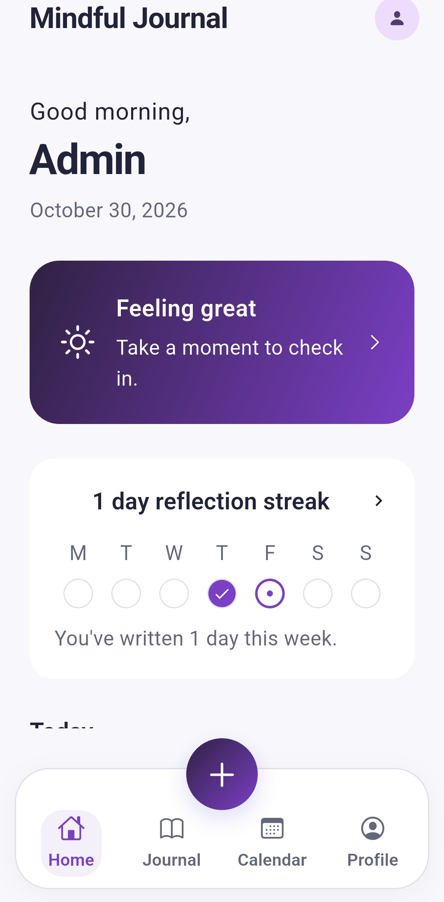
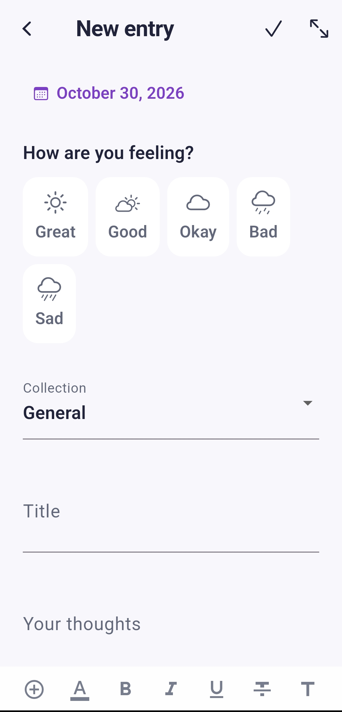
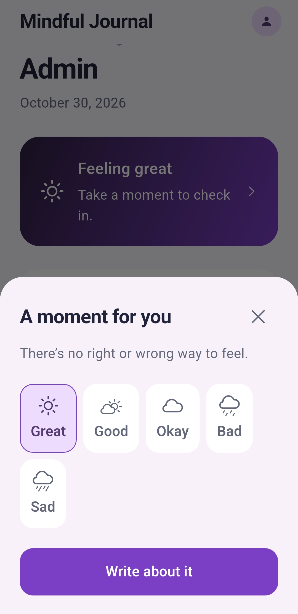
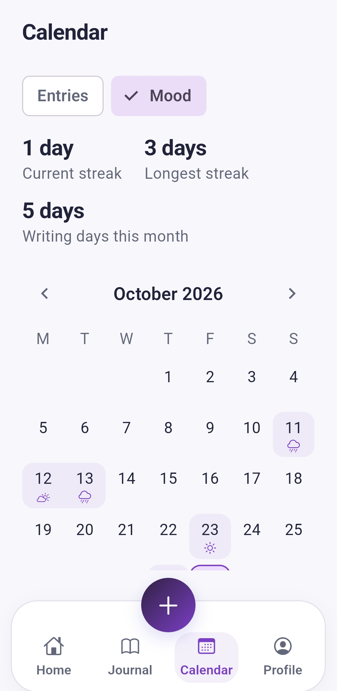
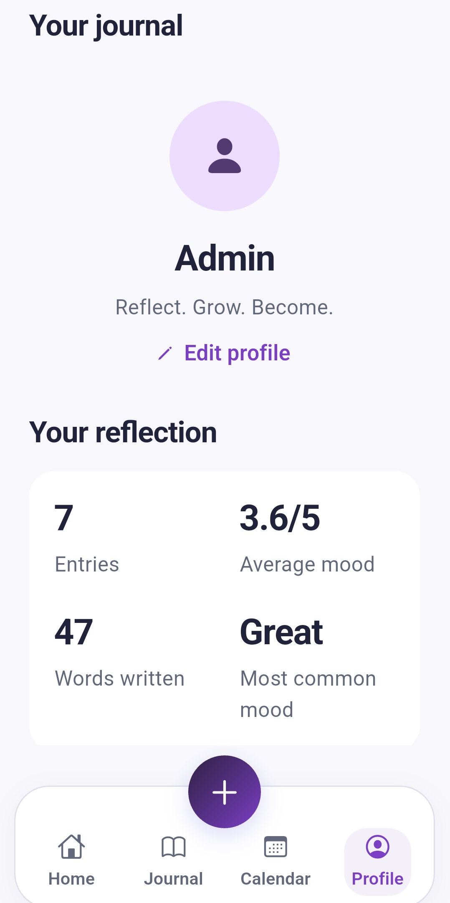
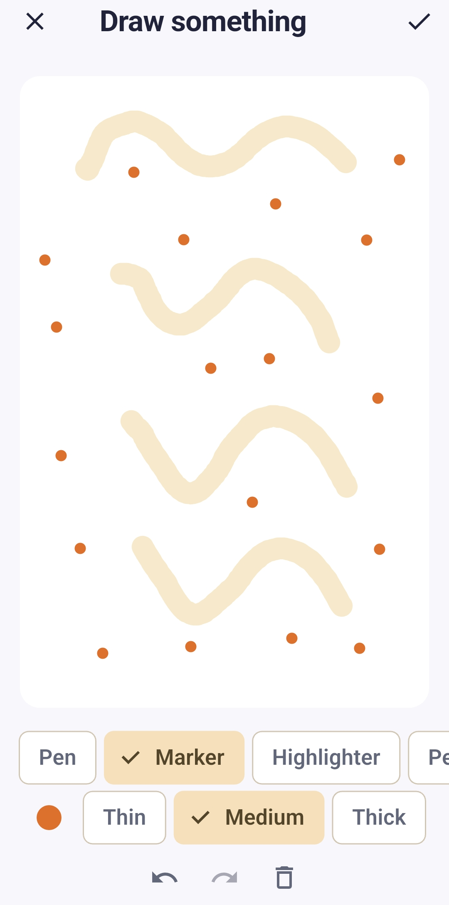

# Mindful Journal — Development & Technical Notes

> **Project documentation** · Mindful Journal is a standalone Flutter journaling application by Fiel Mark E. Oronos. This file preserves implementation details that complement the [main project README](../README.md).

Mindful Journal is an iOS-inspired personal journaling experience with mood tracking, expressive writing tools, local persistence, and adaptive layouts.

## Application screenshots

These are the **same six screenshots** referenced in the repository's main `README.md`. Because this file lives inside `docs/`, its links use `screenshots/filename.png` rather than `docs/screenshots/filename.png`. Upload each image **once** to `docs/screenshots/`.

| Home | Journal editor | Mood check-in |
|:---:|:---:|:---:|
|  |  |  |

| Calendar | Profile and themes | Drawing canvas |
|:---:|:---:|:---:|
|  |  |  |

**Exact upload folder:** `docs/screenshots/`

**Exact filenames:** `home.png`, `journal-editor.png`, `mood-check-in.png`, `calendar.png`, `profile-themes.png`, `drawing-canvas.png`.

> Image previews will appear only after the matching files are uploaded. Use authentic screenshots of the running application.

## Implemented journaling features

- Five-choice mood check-in, with the selected mood carried into the entry editor.
- Create, read, edit, and confirm deletion of entries; title/body validation, date selection, word counts, and protection against losing unsaved edits.
- Chronological journal timeline grouped by month, including empty states.
- Search and filters for mood, media, tags, and Favorites, with highlighted matches.
- Writing streaks, calendar history, and backdated entries.
- Rich-text formatting, selected-text and typing styles, text colors and highlights, undo/redo, and Focus mode.
- Up to four photos and two editable drawings per entry; zoomable media previews.
- Canvas tools: Pen, Marker, Highlighter, Pencil, Eraser, undo/redo, and clear.
- Editable checklists, Favorites, secondary Insights, and task-related functionality.
- Editable name, tagline, profile photo preview, accent themes, custom color picker, and System/Light/Dark appearance.
- Responsive layouts for phone, tablet, and desktop, including keyboard shortcuts and accessibility-related semantics.

## Storage and persistence

The app stores profile and appearance preferences using `shared_preferences`. It uses `path_provider` to access the Application Documents Directory for JSON journal records and app-managed media.

- Saved entries, tasks, checklists, Favorites, tags, collections, profile data, and preferences are loaded on startup.
- Mutations queue serialized disk writes. The editor and quick check-in confirmation wait for saving to finish.
- Sample entries are inserted only when neither a saved journal nor a recovery file exists. An intentionally empty saved journal stays empty on reopening.
- Selected photos are validated, normalized to a maximum dimension of 1024 px, and saved as PNG files under application-owned storage.

See [Local Persistence Report](LOCAL_PERSISTENCE_REPORT.md) for implementation and verification details.

## Project organization

| Path | Responsibility |
|---|---|
| `lib/app/app.dart` | Root application state, startup hydration, persistence callbacks, themes |
| `lib/models/journal_entry.dart` | Journal entry and mood models |
| `lib/core/` | Design tokens, formatting, sorting, and shared logic |
| `lib/screens/` | Main app screens, editor, reading, timeline, and profile |
| `lib/widgets/` | Reusable controls, canvas, cards, and empty states |
| `test/` | Behavioral and responsive-layout tests |
| `tools/generate_branding.py` | Branded icon and launch image preparation |

## Running and checking the project

Prerequisites: a compatible Flutter SDK and Dart installation. The supplied project notes record validation with Flutter **3.47.7** and Dart **3.13.5**; verify against the current checkout before presenting those as fresh test results.

```sh
flutter pub get
flutter run
flutter analyze
flutter test
```

## Platform and release notes

The repository contains Android, iOS, and macOS runners. The project notes report a successful Android release APK build at `build/app/outputs/flutter-apk/app-release.apk`. A physical Android installation, force-stop, and reopening acceptance check was still outstanding at the time of that report. Responsive widget checks cover mobile, tablet, desktop, landscape, and enlarged text.

Do not describe the app as published on the App Store or Play Store unless that has been independently confirmed.

## Branding and design

The supplied app icon master is at `assets/images/app_icon.png`. The iOS launcher icon and launch-image assets are generated from the approved artwork. Keep the supplied master unchanged unless deliberately revising branding.

The project also has design and development reports covering writing experiences, prompt packs, collections, quick check-ins, layout refinements, and settings. Some earlier reports describe runtime-only behavior, which should not be confused with the later local-persistence implementation.

## Further technical documentation

- [Architecture](ARCHITECTURE.md)
- [Design system](DESIGN_SYSTEM.md)
- [Local persistence](LOCAL_PERSISTENCE_REPORT.md)
- [Product experience](PRODUCT_EXPERIENCE_REPORT.md)
- [Settings, tasks, and layouts](SETTINGS_TASKS_VIEWS_REPORT.md)
- [Release guide](RELEASE_GUIDE.md)
- [Icon integration](ICON_INTEGRATION_REPORT.md)
- [Production roadmap](PRODUCTION_ROADMAP.md)

> These notes document the application; they are not a claim of public production release or completion of every future roadmap item.
